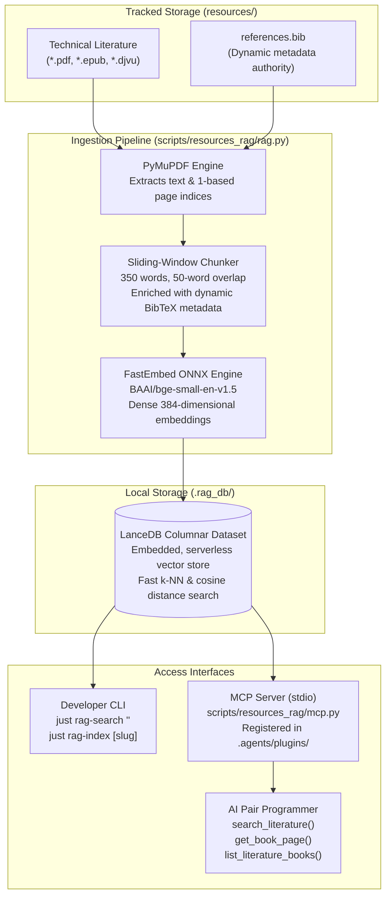

# Educational Literature & Offline RAG Architecture (`resources/`)

This directory houses technical literature, canonical textbooks, research papers, and bibliography metadata supporting the implementation, design decisions, and learning objectives of the `trash-gather` runtime.

Rather than relying on static, manually curated chapter indexes, the repository employs a dynamic, 100% local, offline **Retrieval-Augmented Generation (RAG)** system integrated directly into the pair-programming environment via the **Model Context Protocol (MCP)**.

- **Bibliography Database**: [`references.bib`](./references.bib)
- **Local Vector Database**: `.rag_db/` (LanceDB columnar storage, gitignored)
- **RAG Engine & Typer CLI**: [`scripts/resources_rag/rag.py`](../scripts/resources_rag/rag.py)
- **MCP Server**: [`scripts/resources_rag/mcp.py`](../scripts/resources_rag/mcp.py)
- **Agent Plugin Config**: [`.agents/plugins/literature-rag/`](../.agents/plugins/literature-rag/)

______

## 📐 Architecture Overview



______

## 📚 Dynamic Bibliography & Literature Management

The literature repository is completely agnostic of specific titles or authors. All indexing, metadata resolution, and citation generation are handled dynamically at runtime through [`references.bib`](./references.bib).

### The BibTeX Single Source of Truth

Every document placed in this directory must have a corresponding `@book` or `@article` entry in [`references.bib`](./references.bib):

```bibtex
@book{citekey,
  title     = {Complete Title of the Volume},
  author    = {Primary Author and Secondary Author},
  year      = {2024},
  publisher = {Academic Press},
  file      = {resources/author_2024_title_slug.pdf},
}
```

When the RAG pipeline processes documents, it parses `references.bib` on the fly to attach authoritative titles, author lists, publication years, and citation keys to every chunk. If an untracked document is discovered on disk, the system automatically synthesizes clean metadata from its filename without crashing or requiring code edits.

### File Naming Convention

All literature files stored in this directory strictly adhere to:

```text
resources/<author_surname>_<year>_<short_title_slug>.<ext>
```

- **`<author_surname>`**: Lowercase ASCII surname of primary author.
- **`<year>`**: 4-digit publication year.
- **`<short_title_slug>`**: Concise title slug separated by underscores.
- **`<ext>`**: Document format (`.pdf`, `.epub`, `.djvu`).
- **Character Invariant**: Strictly lowercase alphanumeric and underscores (`^[a-z0-9]+_[0-9]{4}_[a-z0-9_]+\.(pdf|epub|djvu)$`).

### Parity Verification

Bidirectional consistency is enforced by the CI pipeline and pre-commit hooks via `just lint-resources`:

- Every physical file on disk must have a valid BibTeX entry in `references.bib`.
- Every `file = {resources/...}` path in `references.bib` must exist physically on disk.
- All filenames must conform to the naming invariant.

______

## ⚙️ Ingestion & Chunking Pipeline

### 1. Document Parsing (`pymupdf`)

Parsing is performed using PyMuPDF (MuPDF C++ bindings), enabling high-speed extraction across multi-thousand-page volumes in seconds. The parser extracts text while maintaining strict 1-based page counters, guaranteeing that digital passage citations map directly to physical book page numbers.

### 2. Context-Preserving Sliding Window

Technical systems literature contains code snippets, inductive proofs, and structural diagrams that lose semantic meaning if severed abruptly:

- **Chunk Size**: Target window of **350 words**.
- **Sliding Overlap**: Fixed overlap of **50 words** between consecutive chunks.
- **Boundary Preservation**: Text is normalized to remove line-wrap hyphenation and extraneous whitespace while preserving structural layout.
- **Metadata Tagging**: Each chunk is bundled with its source document slug, display title, author, year, citation key, page number, and chunk index within the page.

______

## 🧮 Local Vector Embeddings & Mathematics

### Offline ONNX Runtime Embeddings

To avoid cloud API latency, recurring token costs, and external network dependencies, embeddings are generated locally:

- **Model**: `BAAI/bge-small-en-v1.5` executed via **FastEmbed**.
- **Runtime**: ONNX Runtime optimized for host hardware (Apple Silicon / CPU).
- **Footprint**: Lightweight quantized model (~67 MB) loaded in-process.

### Mathematical Space & Similarity

The embedding model transforms arbitrary text passages into dense vectors in 384-dimensional Euclidean space:

$$\vec{v} \in \mathbb{R}^{384}, \quad \|\vec{v}\|_2 = 1$$

Given a search query $\vec{q}$ and candidate chunk vectors $\vec{d}_i$, similarity is evaluated using **Cosine Distance**:

$$d(\vec{q}, \vec{d}_i) = 1 - \frac{\vec{q} \cdot \vec{d}_i}{\|\vec{q}\|_2 \|\vec{d}_i\|_2} = 1 - (\vec{q} \cdot \vec{d}_i)$$

Smaller distance values indicate stronger conceptual relevance. When queries use technical vocabulary (e.g. *"tri-color invariant"*, *"flexible array member"*, *"write barrier"*), the vector representation captures conceptual proximity even when exact keywords differ.

______

## 🗄️ Columnar Storage (`LanceDB`)

Vector embeddings and associated metadata are stored in a local, serverless LanceDB table under `.rag_db/` (gitignored).

### Why Lance Format?

- **Serverless & In-Process**: Runs directly inside Python via PyArrow without external databases, Docker containers, or background daemon processes.
- **Columnar Layout**: Separate columnar storage for vector embeddings and document payloads enables fast nearest-neighbor ($k$-NN) scans and metadata filtering.
- **Dataset Schema**:

| Field | Type | Description |
| :--- | :--- | :--- |
| `id` | `string` | Unique chunk identifier (`<slug>_p<page>_<idx>`) |
| `vector` | `fixed_size_list<float>[384]` | Dense unit vector embedding |
| `book_slug` | `string` | Document slug for targeted filtering |
| `title` | `string` | Human-readable title from `references.bib` |
| `author` | `string` | Author attribution |
| `year` | `string` | 4-digit publication year |
| `citation_key` | `string` | BibTeX citation identifier |
| `page` | `int32` | 1-based page number |
| `chunk_index` | `int32` | Chunk index within the page |
| `text` | `string` | Extracted passage text |

______

## 🛠️ Developer CLI Reference (`justfile`)

All RAG operations are integrated into the project's `justfile` interface:

### 1. Semantic Literature Search

Search across the entire indexed corpus using conceptual queries:

```bash
just rag-search "<concept or query>"
```

*Example*:

```bash
just rag-search "pointer aliasing and strict aliasing rules"
```

Filter search results to a specific document by slug or author:

```bash
just rag-search "mark-sweep collection" book="<author_or_slug>"
```

Control the number of returned matches:

```bash
just rag-search "virtual memory page tables" limit="10"
```

### 2. Full Corpus Indexing

Index all supported documents (*.pdf,*.epub) located in `resources/`:

```bash
just rag-index
```

### 3. Targeted Single-Document Reindexing

Reindex or update a single document without rebuilding the entire database:

```bash
just rag-index <slug_or_author>
```

### 4. Database Diagnostics & Statistics

Inspect total indexed chunks and database disk location:

```bash
just rag-stats
```

### 5. Parity & Validation Checks

Verify strict synchronization between physical media files and `references.bib`:

```bash
just lint-resources
```

______

## 🤖 Model Context Protocol (MCP) Integration

The RAG pipeline is exposed as a repository-local **MCP Server** configured under [`.agents/plugins/literature-rag/`](../.agents/plugins/literature-rag/).

### Communication Transport

The MCP server operates over standard I/O (`stdio`). When an Antigravity agent starts, the environment spawns the Python server process (`scripts/resources_rag/mcp.py`) and discovers available tools dynamically.

### Agent Tool Interfaces

#### 1. `search_literature`

- **Signature**: `search_literature(query: str, book: str = "", limit: int = 5) -> str`
- **Purpose**: Semantically search the literature corpus and return Markdown-formatted excerpts with exact book titles, years, page numbers, and cosine distance scores.
- **Filtering**: Optional `book` parameter filters results by author surname or title slug.

#### 2. `get_book_page`

- **Signature**: `get_book_page(book_slug: str, page_number: int) -> str`
- **Purpose**: Retrieve the complete verbatim text of a specific physical page from any document in `resources/` on demand.
- **Use Case**: Allows the agent to expand on a relevant search result and examine surrounding context, mathematical proofs, or algorithm pseudocode.

#### 3. `list_literature_books`

- **Signature**: `list_literature_books() -> str`
- **Purpose**: Returns a Markdown table detailing all available literature volumes, page counts, file formats, and indexing status.

### Socratic Tutoring & Quality Gatekeeping

During milestone initialization, code reviews, and debugging triage:

- **Grounded Foundations**: Agents query the local RAG to cite formal definitions, standard specifications, and hardware mechanics rather than generic intuitions.
- **No Hallucination**: Citations reference verifiable page numbers in tracked volumes that the human developer can open and verify immediately.
- **Architectural Parity**: When discussing memory management tradeoffs (e.g. mark-sweep vs. reference counting vs. copying collectors), the agent anchors advice in canonical literature.
